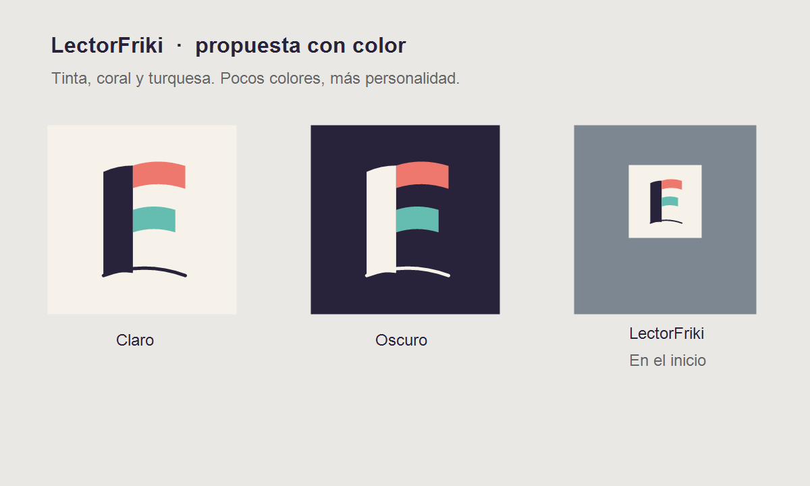

# LectorFriki

LectorFriki es una aplicación gratuita para leer cómics y manga en Android. Se diseñó y probó pensando especialmente en teléfonos y tablets Galaxy, pero usa las API estándar de Android y no depende de un modelo Samsung concreto.

## Funciones

- Importar archivos CBZ, CBR y PDF desde el selector de archivos de Android.
- Biblioteca local con portadas, progreso de lectura y colecciones.
- Lectura de derecha a izquierda, izquierda a derecha y desplazamiento vertical.
- Ajustes de página «Pantalla», «Ancho», «Alto» y «Llenar».
- Modo claro y oscuro, lectura inmersiva y doble página en tablets.

Los archivos originales siguen en su ubicación. La aplicación trabaja sin cuenta y sin conexión para leerlos.

## Instalar

Los APK de distribución se publicarán en [Releases](../../releases). Descarga el archivo `.apk` de la versión más reciente desde allí y ábrelo en tu dispositivo. Android puede pedirte habilitar la instalación desde tu navegador o gestor de archivos. Las actualizaciones deben estar firmadas con la misma clave que la instalación anterior; no desinstales una versión que contenga una biblioteca que quieras conservar.

**Estado de la distribución:** el código de la versión 1.4 está listo. El APK de prueba firmado con clave de desarrollo se entregó al autor, pero aún no hay una versión pública firmada para distribuir. No publiques una clave de firma en este repositorio.

## Compilar en Android Studio

1. Abre esta carpeta (la que contiene `settings.gradle.kts`).
2. Usa JDK 17 o 21 e instala Android SDK 35.
3. Espera la sincronización de Gradle y ejecuta la configuración `app` en un dispositivo o emulador.

En Windows también puedes usar `gradlew.bat :app:assembleDebug` para generar un APK local de pruebas. `gradlew.bat :app:lintDebug` ejecuta el análisis estático.

## Firma y datos

`applicationId` y `namespace`: `com.panels.reader`. El nombre visible es LectorFriki. Para distribuir nuevas versiones, conserva una clave de firma privada fuera del repositorio. La biblioteca y las colecciones se guardan localmente en la app; una instalación con firma diferente no podrá actualizarse encima de otra. Antes de pasar a una firma pública distinta, conviene implementar una copia de seguridad y restauración de biblioteca y colecciones.

## Estructura

- `app/src/main`: aplicación Android con interfaz Jetpack Compose.
- `checks`: comprobaciones ligeras de paginación y colecciones.
- `gradle/wrapper`: versión de Gradle requerida por el proyecto.

## Estado

Versión 1.4.0. Compilación `assembleDebug` y `lintDebug` correctas. Se comprobó importación y lectura de un CBZ sintético en emulador Android API 37 y actualización 1.3 → 1.4 conservando la biblioteca. Queda pendiente una prueba pública con más archivos y dispositivos.

## Licencia

Este proyecto se distribuye bajo la [licencia MIT](LICENSE).

